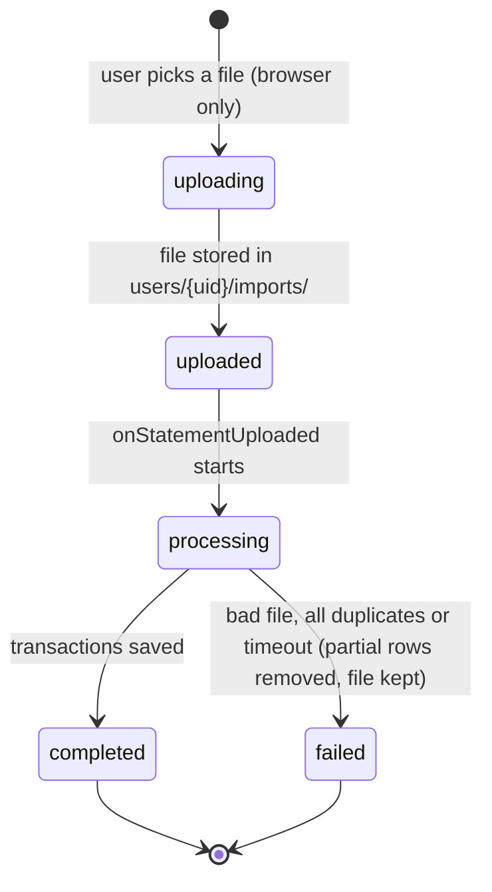
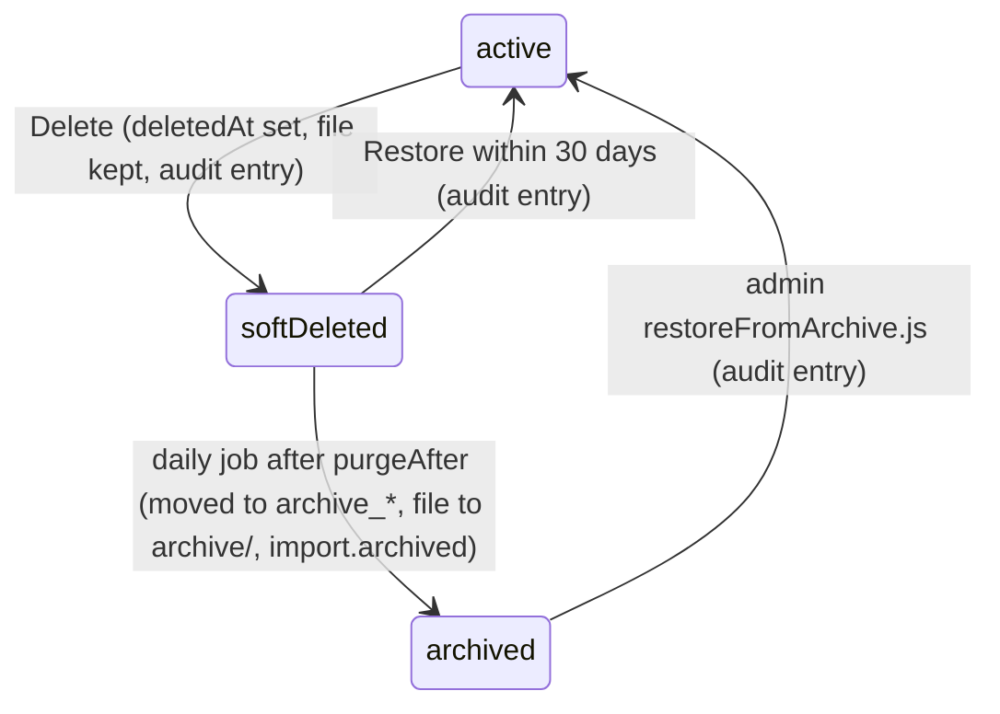

# Data Framework: Storage, Deletion, Archive and Backups

How Budgetly stores user data, what happens when a user deletes something, where deleted data goes after 30 days (the **archive**), and how we keep **backups** of the live database. Updated for Sprint 5 (ticket #10).

Related: [system-architecture.md](system-architecture.md) covers the overall stack, and [data-duplication-audit.md](data-duplication-audit.md) lists what each document stores. The data schemas are in **budgetly_contracts** (`schemas/data-model.md`), which is the source of truth.

## Summary

* Transactions live in one top-level `transactions` collection. Each one carries its owner's uid in a required `userId` field (SCRUM-109). Everything else is under the user's uid: `users/{uid}/...` in Firestore, and `users/{uid}/imports/...` in Storage.
* `userId` always comes from the verified Firebase login token, never from the request body, so nobody can act as another user (see [Trust model](#trust-model)).
* A delete is never immediate. It's a **soft delete**: the data is marked with `deletedAt`, hidden from the app, and can be restored for 30 days (Sprint 4).
* **After 30 days, deleted data is archived, not destroyed** (Sprint 5, this plan). The daily job moves it to admin-only `archive_*` collections in the same database, and moves the statement file to `archive/` in Storage. Users can't see or reach the archive. An admin can restore from it.
* **Backups** are separate. Every day the same job exports the whole live database to Storage under `backups/YYYY-MM-DD/` and keeps the last 7 days. They're for recovering from a mistake or corruption, not for keeping old data.
* Everything stays at **$0**: one database, no paid backup feature, and no new scheduled job (see [Why it costs nothing](#why-it-costs-nothing)).

## Archive vs backups

They sound alike but answer different questions.

| | Archive | Backups |
| --- | --- | --- |
| What it is | Data we **chose to keep** after the user deleted it and the 30 days ran out | **Copies of the live database** at a moment in time |
| What's in it | Only deleted-and-expired statements, transactions and budgets | Everything (all users, all collections, the archive too) |
| Where | Firestore `archive_transactions`, `archive_imports`, `archive_budgets`; Storage `archive/users/{uid}/imports/...` | Storage `backups/YYYY-MM-DD/` (Firestore export files) |
| How long | Kept (see [Open questions](#open-questions)) | 7 days, then deleted |
| Protects against | Losing history when something is deleted for good; lets an admin answer "what was in that statement?" | A bad deploy, a buggy script or a mistaken bulk change damaging live data |
| Restore | Admin script puts single records back (`restoreFromArchive.js`) | `gcloud firestore import` of a whole day's export (all or nothing, admins only) |
| Who can read it | Admins only (Admin SDK / console). Rules deny every client | Admins only. Storage rules deny every client |

## Current Data Model

All data lives in one Firebase project (`budgetly-backend-nodejs`), in the **default** Firestore database and the **default** Storage bucket.

| Data | Location | Written by | Client access |
| --- | --- | --- | --- |
| User profile and settings | Firestore `users/{uid}` | Web app at signup and on Settings | Owner reads and updates some fields, can't delete |
| Raw statement file (CSV/PDF) | Storage `users/{uid}/imports/{timestamp}_{fileName}` | Web app (`src/lib/uploads.js`) | Owner uploads and reads only (no update or delete) |
| Import record | Firestore `users/{uid}/imports/{importId}` | `onStatementUploaded` and the delete/restore functions | Read only |
| Imported transactions | Firestore `transactions/{uid}_{importId}_{rowNumber}` (row number padded to 5 digits; `sourceStatementId` = the importId) | `onStatementUploaded` | Read, re-categorize only |
| Manual transactions | Firestore `transactions/{autoId}` (`source: "manual"`) | Web app | Owner creates, edits, soft deletes, restores |
| Budgets | Firestore `users/{uid}/budgets/{categoryId}` | Web app | Owner creates, edits, soft deletes, restores |
| Monthly budget record | Firestore `users/{uid}/budgetMonths/{YYYY-MM}` (SCRUM-137) | Web app | Owner creates once per month; only `savings` can change |
| Merchant category memory | Firestore `users/{uid}/merchantCache/{docId}` | `onTransactionCategoryChanged` | None |
| Audit log | Firestore `auditLog/{autoId}` (top level, with `userId`) | Cloud Functions only | Owner reads their own entries |
| **Archive** (new) | Firestore `archive_transactions`, `archive_imports`, `archive_budgets`; Storage `archive/users/{uid}/imports/...` | Daily job only | **None** |
| **Backups** (new) | Storage `backups/YYYY-MM-DD/` | Daily job and `npm run backup` | **None** |

Since Sprint 5 (#2), an import record doesn't store copies of data kept elsewhere. Its file name and type come from `storagePath`, the account type from its account, and the number of transactions is counted from `transactions` (`sourceStatementId == importId`). It no longer has `transactionCount`, `fileName`, `fileType` or `accountType`.

Access is enforced by `firestore.rules` and `storage.rules` in budgetly_backend_nodejs. Cloud Functions and admin scripts use the Admin SDK, which skips the rules. So only they can write import records, imported transactions, the audit log, the archive and backups.

**Finding one account's data:** look up the UID under Authentication, then:
* Firestore: `users/{UID}` and its subcollections (imports, budgets, budgetMonths, merchantCache), plus `transactions` and `auditLog` filtered by `userId == UID`, plus the `archive_*` collections filtered by `userId == UID`.
* Storage: `users/{UID}/imports/` (live files) and `archive/users/{UID}/imports/` (archived files).

## Trust model

Two questions: where does `userId` come from, and what stops someone from pretending to be another user (for example by sending requests from Postman)?

### Where `userId` comes from

Always from the user's verified Firebase ID token (the login token the Firebase SDK sends with every request). Never from the request body.

| Where | How the uid is read |
| --- | --- |
| Firestore rules | `request.auth.uid` |
| Callable functions (`onCall`: `softDeleteImport`, `restoreImport`, `deleteImport`) | `request.auth.uid`. `onCall` checks the token itself, and the function refuses the call if no one is signed in (SCRUM-112) |
| Import trigger `onStatementUploaded` | Taken from the Storage path `users/{uid}/imports/...`. `storage.rules` only let the signed-in owner upload to their own folder, so the path can be trusted. Nothing in the file or its metadata can change it |
| Daily job and admin scripts | No user: they run as the server (Admin SDK) and act as `"system"` in the audit log |

### Why Postman can't impersonate another user

* The ID token is signed by Google. Firebase checks that signature on the server, so a request can only act as the user whose token it carries. Editing the token to say a different uid breaks the signature.
* Putting `userId: "someone-else"` in the body does nothing. The rules compare it to `request.auth.uid` and reject a mismatch, and the functions ignore it and use the token's uid.
* With no token, or an invalid one, `request.auth` is `null` and everything is denied.
* Cloud Functions use the Admin SDK, which skips the rules. So every function checks ownership itself (for example, `softDeleteImport` only looks under the caller's own `users/{uid}`).

### Rules that enforce it (SCRUM-113)

For `transactions/{transactionId}`:

* Read: `resource.data.userId == request.auth.uid`.
* Create (manual only): `request.resource.data.userId == request.auth.uid`.
* Update: `userId`, `source` and `sourceStatementId` can never change.
* Delete from the client: never allowed (deleting is a soft delete, below).
* A list query without `where("userId", "==", <own uid>)` is rejected. Rules aren't filters: Firestore won't quietly drop other users' documents, it refuses the whole query.

For the archive and backups (new): no client may read or write anything (see [Rules](#rules-for-the-archive-and-backups)).

### Proof

* Rules tests: SCRUM-114, `test/firestore.rules.test.js` in budgetly_backend_nodejs.
* Postman demo: SCRUM-115, [postman-impersonation-demo.md](postman-impersonation-demo.md). Signed in as user A, every attempt to read, create, change or delete user B's transactions returns 403.

## Import Lifecycle



## Deleting: soft delete and restore (built in Sprint 4)

Before Sprint 4, deleting a statement, a manual transaction or a budget removed it for good, with no undo and no record of who did it. Sprint 4 replaced that with soft deletes.

### Soft delete fields

| Field | Type | Meaning |
| --- | --- | --- |
| `deletedAt` | timestamp or `null` | When it was deleted. `null` = active |
| `deletedBy` | uid or `null` | Who deleted it |
| `purgeAfter` | timestamp or `null` | `deletedAt` + 30 days. After this the daily job archives it (the name is kept so existing data and indexes still work) |

These fields are on import records, transactions (imported and manual) and budgets. New documents are created with `deletedAt: null`, so queries can filter on it.

### What a delete does

| Action | How | Transactions | Import record | File | Undo |
| --- | --- | --- | --- | --- | --- |
| Delete statement | `softDeleteImport` callable (SCRUM-120) | Marked deleted, in batches of 400 | Marked deleted | Kept in `users/{uid}/imports/` | **Restore** in Recently deleted (`restoreImport`, SCRUM-121), within 30 days |
| Delete manual transaction | Browser update (rules allow only the three fields) | Marked deleted | n/a | n/a | Undo toast, or Restore in Recently deleted |
| Remove budget | Browser update | n/a | n/a | n/a | Undo toast, or Restore in Recently deleted |
| Import fails or times out | `onStatementUploaded` | Partial rows removed | Kept, status `failed` | Kept | n/a |

The import record is the main copy of a statement's deleted state. Today its transactions carry the same three fields, so the Transactions page and the server queries can filter on `deletedAt == null` directly (audit item D2, kept for now).

The older `deleteImport` callable (an immediate hard delete) is still deployed but the app no longer calls it.

## After 30 days: the archive (Sprint 5 plan)

Today (SCRUM-127, SCRUM-122) the daily `purgeDeleted` job **permanently deletes** anything whose `purgeAfter` has passed. This plan changes that step to **archive** instead. Nothing a user deleted is destroyed; it leaves the live data and goes where only admins can see it.

### Where archived data goes

All in the **default** database and bucket. There's no second database.

| Live location | Archive location | Archive doc ID |
| --- | --- | --- |
| `transactions/{id}` | `archive_transactions/{id}` | Same ID (already unique and contains the uid) |
| `users/{uid}/imports/{importId}` | `archive_imports/{uid}_{importId}` | uid + importId (importIds are only unique per user) |
| `users/{uid}/budgets/{categoryId}` | `archive_budgets/{uid}_{categoryId}` | uid + categoryId |
| Storage `users/{uid}/imports/{file}` | Storage `archive/users/{uid}/imports/{file}` | Same file name |

Each archived document keeps **all** its original fields, plus:

| Field | Meaning |
| --- | --- |
| `userId` | The owner (already on transactions; added for imports and budgets from the path) |
| `originalPath` | Where it lived, e.g. `users/abc123/imports/9f2c...`, so it can be put back |
| `archivedAt` | Server timestamp of the move |
| `archivedFilePath` | Imports only: the file's new Storage path (`null` if the file was already gone) |

The archive collections are top-level so the daily job and admin scripts can query them by `userId` with single-field indexes Firestore creates automatically. No composite index is needed.

### How the daily job archives (changes to `purgeJob.js`)

Same safety checks as today: only documents with both `deletedAt` and `purgeAfter` set and `purgeAfter` in the past, a maximum number of pages per run, and the "unchanged since we read it" check.

1. **Statements first** (as since Sprint 5 #2). For each expired import:
   1. Move the file: copy to `archive/users/{uid}/imports/{file}`, then delete the original. Only files in the owner's own folder; a missing file is fine.
   2. In one batched write (all or nothing): create `archive_imports/{uid}_{importId}` and delete the import record, with the delete conditioned on `lastUpdateTime`. A statement restored while the job runs makes the batch fail, and it's skipped. If the batch fails, the file is moved back.
   3. Move its transactions in batches of 200 (each move = one create + one delete, so 400 writes, under Firestore's 500 limit): create `archive_transactions/{id}`, delete `transactions/{id}`.
   4. Write an `import.archived` audit entry (actor `"system"`, details `{ fileName, transactionCount }`, where the count is the number of transactions it moved). This replaces `import.purged`.
2. **Manual transactions and budgets** whose `purgeAfter` has passed: the same create-in-archive + conditional delete, in one batch per page.

Writing the archive copy and deleting the original in the **same batch** means a record is never in both places, and never in neither.

### Restoring from the archive (admin only)

A new admin script, `functions/scripts/restoreFromArchive.js`, run from an admin's machine like the other scripts:

```
node scripts/restoreFromArchive.js --user <uid> --import <importId> [--dry-run]
node scripts/restoreFromArchive.js --user <uid> --transaction <id> [--dry-run]
node scripts/restoreFromArchive.js --user <uid> --budget <categoryId> [--dry-run]
```

It reverses the move: writes the document back to `originalPath` (without `archivedAt`, `originalPath`, `archivedFilePath`), with `deletedAt`, `deletedBy` and `purgeAfter` cleared so it's active again; moves the file back for an import; deletes the archive copy in the same batch; and writes an `import.unarchived` (or `transaction.unarchived` / `budget.unarchived`) audit entry with actor `"admin"`. It refuses if something already exists at `originalPath`. `--dry-run` shows what it would do.

### Deleted data lifecycle



## Backups (Sprint 5 plan)

### What runs

The **existing** daily `purgeDeleted` scheduled function (every day at 3:00 AM Central) gets a first step:

1. **Start a Firestore export** of the default database to `gs://<default bucket>/backups/YYYY-MM-DD/`, using the Firestore Admin API `exportDocuments` (`v1.FirestoreAdminClient` from `@google-cloud/firestore`, which comes with `firebase-admin`). The export runs on Google's side; the function only starts it and logs the operation name.
2. **Delete old backups:** list `backups/` and delete every `backups/YYYY-MM-DD/` folder more than 7 days old. Only folders whose name is a date are touched.
3. **Archive** expired deleted data (above). If starting the export fails, the job logs an error and **skips archiving that day**, so data never leaves the live collections on a day without a fresh backup. It tries again the next day.

On-demand backup: `npm run backup` (in `functions/`) runs `scripts/backupNow.js` from an admin's machine. It starts the same export to `backups/YYYY-MM-DD-manual-HHmm/`, which the 7-day cleanup also removes. Use it before running a risky script or a migration.

One-time setup (free): give the functions' service account the **Cloud Datastore Import Export Admin** role and write access to the default bucket. Without them the export call is refused.

### Restoring a backup

A backup is restored with `gcloud`, never from the app:

```
gcloud firestore import gs://<default bucket>/backups/2026-11-22/ --project <project>
```

* An import **writes** every document in the export over the matching document in the database. It doesn't delete documents created after the backup. So restoring into the live project mixes old and new data. Only do that after deciding exactly what to recover.
* **Practice on a throwaway project or the emulator first, never on live.** Import into a separate test Firebase project, check the data there, and copy only what's needed back with an admin script. (For the emulator: download the export folder with `gsutil cp -r` and start the Firestore emulator with it.)
* An export is not guaranteed to be an exact snapshot: documents changed while it runs may be in either state. For our size it takes seconds, and it runs at 3 AM.

### Why it costs nothing

* **No second database.** The archive is three collections in the default database.
* **No managed backup feature.** Firestore's scheduled backups and point-in-time recovery are paid; we use plain exports instead.
* **No new Cloud Scheduler job.** The backup runs inside the existing daily `purgeDeleted` job.
* **Export reads:** an export is billed as one read per document. At our size (a few thousand documents) that's far below the free 50,000 reads a day. Check the billing report after the first week to confirm.
* **Storage:** 7 days of exports plus archived files are a few MB, well inside the free Storage quota.

## Rules for the archive and backups

The default is already "deny": anything not matched in `firestore.rules` or `storage.rules` is refused. We still add explicit rules, so the intent is written down and tested:

```
// firestore.rules
match /archive_transactions/{id} { allow read, write: if false; }
match /archive_imports/{id}      { allow read, write: if false; }
match /archive_budgets/{id}      { allow read, write: if false; }

// storage.rules
match /archive/{path=**} { allow read, write: if false; }
match /backups/{path=**} { allow read, write: if false; }
```

Rules tests: a signed-in owner can't read or write their own archived documents or files, or any backup file.

## Audit log

Each delete, restore and archive writes an entry to the top-level `auditLog/{autoId}` (SCRUM-120). The owner can read their own entries (`where("userId", "==", uid)`); only the server writes them.

| Field | Example |
| --- | --- |
| `userId` | whose data it was |
| `action` | `"import.deleted"`, `"import.restored"`, `"import.archived"` (replaces `"import.purged"`), `"import.unarchived"` |
| `targetPath` | `"users/abc123/imports/9f2c..."` |
| `actor` | the user's uid, `"system"` for the daily job, `"admin"` for admin scripts |
| `at` | server timestamp |
| `details` | e.g. `{ fileName, transactionCount }`: what the action affected at that moment |

Older entries say `import.purged`; they stay as they are (history doesn't change).

## Implementation plan

### budgetly_backend_nodejs

1. `lib/purgeJob.js` → archive instead of delete (above). Rename `runPurge` to `runArchive` but keep the `purgeDeleted` function name so the existing schedule keeps working.
2. `lib/backupJob.js`: start the export, delete backups older than 7 days. Called first by `purgeDeleted`; archiving is skipped if it fails.
3. `scripts/backupNow.js` + `"backup"` in `functions/package.json`.
4. `scripts/restoreFromArchive.js`.
5. `firestore.rules` and `storage.rules`: the explicit deny rules above.
6. Tests:
   * Unit tests for the archive moves (one batch, nothing lost if a restore lands mid-run, transaction count in `import.archived`), backup cleanup (only date folders older than 7 days) and the restore script.
   * Rules tests for the archive and backups.
   * Update the delete-lifecycle walkthrough: after 30 days the data is in `archive_*` and `archive/`, not gone.

### budgetly_web_customer

No change: the app never sees the archive or backups. The Recently deleted text says "removed for good in N days"; change it to "moved out of the app in N days" or similar.

### budgetly_contracts

Add the `archive_*` documents (original fields + `userId`, `originalPath`, `archivedAt`, `archivedFilePath`) and the new audit actions to `schemas/data-model.md`.

## Testing so far

### Delete lifecycle walkthrough (SCRUM-128)

A repeatable script runs the whole life of an imported statement on the local emulators (Auth, Firestore, Storage and Functions, project `demo-budgetly`) through the real Cloud Functions, and prints PASS/FAIL for each step. It never touches the real project.

```
cd budgetly_backend_nodejs/functions
npm run walkthrough
```

Script: `functions/scripts/walkthroughDeleteLifecycle.js`. Test statement: `functions/test/fixtures/walkthrough-statement.csv` (6 rows).

| Step | What the script does | What it checks |
| --- | --- | --- |
| 1. Upload | Alice's CSV is uploaded to `users/{uid}/imports/`, so `onStatementUploaded` runs | Import finishes; 6 transactions in `transactions/`, each with `userId` = Alice and `deletedAt: null` |
| 2. Delete | `softDeleteImport` as Alice | Import and all 6 transactions get `deletedAt`, `deletedBy` = Alice and `purgeAfter` 30 days later; nothing removed; file kept; `import.deleted` in the audit log |
| 3. Recently deleted | Reads Alice's imports and active transactions | Listed as deleted; no active transactions left |
| 4. Restore | `restoreImport` as Alice | Delete fields cleared everywhere; `import.restored` in the audit log |
| 5. Another user | Bob calls both with `userId` = Alice in the body; then a call with no login | `NOT_FOUND`, `NOT_FOUND`, `UNAUTHENTICATED`; Alice's data unchanged |
| 6. After 30 days | Alice deletes it again; a late restore is tried; the daily job runs | Restore refused; the statement, its transactions and its file are gone; `import.purged(6)` with actor `"system"`; a second run finds nothing |

Latest result (Nov 22, 2026, with Sprint 5 #2): **all checks passed**. The gaps found on Nov 2 (import record and file left behind, no purge audit entry) were closed by SCRUM-122. Once the archive is built, step 6 will check `archive_*` and `archive/` instead.

## Open questions

* How long do we keep the archive? Kept indefinitely is $0 at our size. A rule like "remove archived data after 1 year" can be added later to the same daily job.
* When account deletion is built, should it soft delete everything under the user the same way, and archive it after 30 days?
* Should a user be able to ask for their archived data back (through an admin), and do we tell them it's kept?
