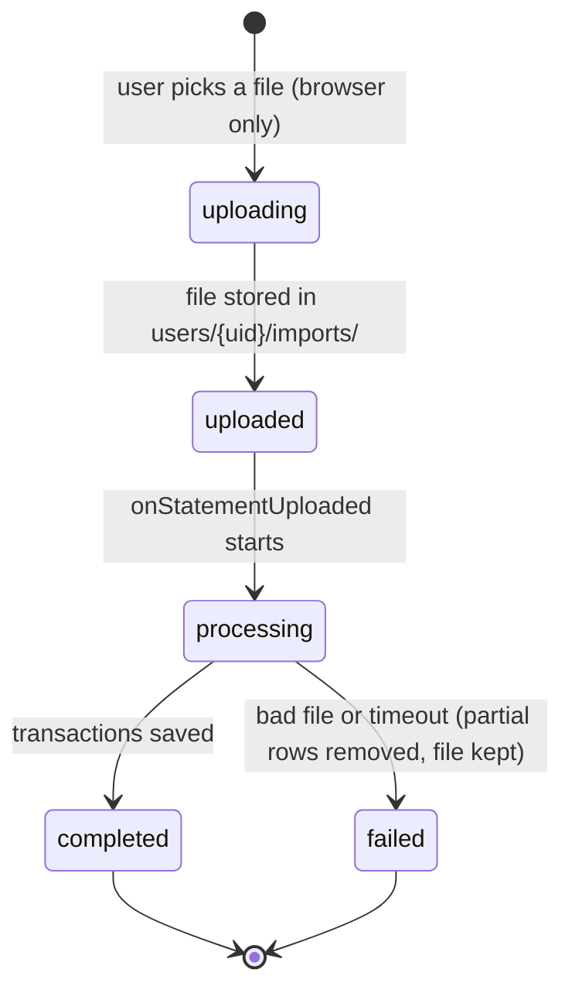
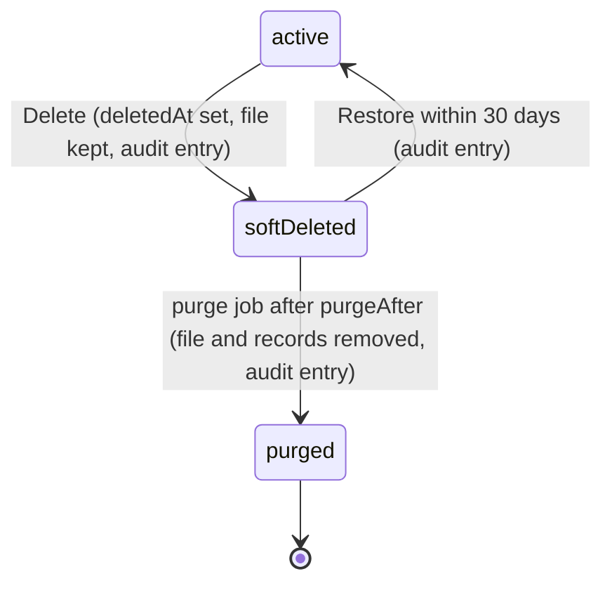

# Data Framework: Storage, Deletion and Retention

How Budgetly stores user data, what happens when data is deleted, and how we will move from permanent (hard) deletes to soft deletes with a retention period and an audit log in Sprint 4.

Related: [system-architecture.md](system-architecture.md) covers the overall stack. Data schemas live in **budgetly_contracts**.

## Summary

* Every piece of user data is stored under the user's Firebase Auth uid: `users/{uid}/...` in both Firestore and Storage. The exception is transactions, which live in the top-level `transactions` collection and carry the owner's uid in a required `userId` field (SCRUM-109).
* `userId` always comes from the verified Firebase login token, never from the request body, so nobody can act as another user (see [Trust model](#trust-model)).
* Today, deleting a statement removes its transactions, its import record and its raw file permanently. Nothing can be recovered and nothing records that it happened.
* The new framework never removes data immediately. A delete marks records with `deletedAt`, keeps the raw file, writes an audit entry, and a scheduled job purges the data after 30 days.

## Current Data Model

All data lives in one Firebase project (`budgetly-backend-nodejs`).

| Data | Location | Written by | Client access |
| --- | --- | --- | --- |
| User profile and settings | Firestore `users/{uid}` | Web app at signup | Owner reads and updates some fields, cannot delete |
| Raw statement file (CSV/PDF) | Storage `users/{uid}/imports/{timestamp}_{fileName}` | Web app (`src/lib/uploads.js`) | Owner reads and uploads only (no update or delete) |
| Import record | Firestore `users/{uid}/imports/{importId}` | `onStatementUploaded` Cloud Function | Read only |
| Imported transactions | Firestore `transactions/{uid}_{importId}_{rowNumber}` (row number padded to 5 digits; `sourceStatementId` = the importId) | `onStatementUploaded` | Read, re-categorize only |
| Manual transactions | Firestore `transactions/{autoId}` (`source: "manual"`) | Web app | Owner creates, edits, deletes |
| Budgets | Firestore `users/{uid}/budgets/{categoryId}` | Web app | Owner creates, edits, deletes |
| Merchant category memory | Firestore `users/{uid}/merchantCache` | `onTransactionCategoryChanged` | None from the client |

Every transaction document has a required `userId` field: the owner's uid. Imports, budgets, settings and the merchant cache stay under `users/{uid}`. The full schema is in budgetly_contracts `schemas/data-model.md`, which is the source of truth.

Access is enforced by `firestore.rules` and `storage.rules` in budgetly_backend_nodejs. Cloud Functions use the Admin SDK, which bypasses the rules, so only they can write import records and imported transactions.

## Trust model

Two questions: where does `userId` come from, and what stops someone from pretending to be another user (for example by sending requests from Postman)?

### Where `userId` comes from

Always from the user's verified Firebase ID token (the login token the Firebase SDK sends with every request). Never from the request body.

| Where | How the uid is read |
| --- | --- |
| Firestore rules | `request.auth.uid` |
| Callable functions (`onCall`, e.g. `deleteImport`, `categorizeTransactions`) | `request.auth.uid` (`context.auth.uid` in v1). `onCall` verifies the token automatically, and the function rejects the call if there is no signed-in user |
| Import trigger `onStatementUploaded` | Taken from the Storage path `users/{uid}/imports/...`. `storage.rules` only let the signed-in owner upload to their own folder, so the path can be trusted. Nothing in the file contents or metadata can change it |

### Why Postman can't impersonate another user

* The ID token is signed by Google. Firebase checks that signature on the server, so a request can only act as the user whose token it carries. A token can't be edited to say a different uid without breaking the signature.
* Putting `userId: "someone-else"` in the body does nothing. The rules compare it to `request.auth.uid` and reject a mismatch, and the functions ignore it and use the token's uid.
* With no token, or an invalid one, `request.auth` is `null` and everything is denied.
* Cloud Functions use the Admin SDK, which bypasses the rules. So every function must check ownership itself (for example, `deleteImport` only looks under the caller's own `users/{uid}`).

### Rules that enforce it (planned, built in SCRUM-113)

For `transactions/{transactionId}`:

* Read: `resource.data.userId == request.auth.uid`.
* Create: `request.resource.data.userId == request.auth.uid`.
* Update: `userId` must stay the same.
* Delete from the client: never allowed (deleting is a soft delete, see below).
* A list query without `where("userId", "==", <own uid>)` is rejected. Rules aren't filters: Firestore won't quietly drop other users' documents, it refuses the whole query.

### Proof

* Rules tests: SCRUM-114, `test/firestore.rules.test.js` in budgetly_backend_nodejs.
* Postman demo: SCRUM-115, [postman-impersonation-demo.md](postman-impersonation-demo.md). Signed in as user A, every attempt to read, create, change or delete user B's transactions returns 403.

A new account has a new uid, so its files appear in a new folder in the Storage console. To find an account's data, look up its UID under Authentication, then open `users/{UID}` in Storage and Firestore.

## Import Lifecycle

## Current Delete Behavior

| Action | Transactions | Import record | Raw file | Recoverable |
| --- | --- | --- | --- | --- |
| Delete statement (`deleteImport` callable) | Permanently deleted | Permanently deleted | Permanently deleted | No |
| Delete manual transaction (client) | Permanently deleted | n/a | n/a | No |
| Delete budget (client) | Budget doc permanently deleted | n/a | n/a | No |
| Import fails or times out | Partial rows removed | Kept, status `failed` | Kept | File only |

Problems with this:

* No undo. A misclick loses a whole statement of financial history.
* No traceability. Once the file is gone, transactions can't be traced back to their source, and nothing shows who deleted what or when.
* Not standard practice. Financial applications normally retain records for a period and purge them on a schedule.

## New Framework

### 1. Soft delete

Deleting sets fields instead of removing the document:

| Field | Type | Meaning |
| --- | --- | --- |
| `deletedAt` | timestamp or `null` | When it was deleted. `null` = active |
| `deletedBy` | string (uid) | Who deleted it |
| `purgeAfter` | timestamp | `deletedAt` + 30 days. The purge job removes it after this |

These fields go on import records, transactions (imported and manual) and budgets. Every new document is created with `deletedAt: null` so queries can filter on it.

### 2. Keep the raw file

The statement file stays in `users/{uid}/imports/` while the import is soft deleted. It is removed only by the purge job. Storage rules are unchanged: the client still can't delete files.

### 3. Restore

A "Recently deleted" list on the Import page shows soft-deleted statements with a **Restore** button. Restoring clears `deletedAt`, `deletedBy` and `purgeAfter` on the import and its transactions.

### 4. Scheduled purge

A scheduled Cloud Function runs once a day and permanently deletes anything whose `purgeAfter` has passed: transactions, the import record and the raw file. This reuses the existing hard-delete logic in `deleteImport.js`.

### 5. Audit log

Each upload, delete, restore and purge writes an entry to `users/{uid}/auditLog/{autoId}`:

| Field | Example |
| --- | --- |
| `action` | `"import.uploaded"`, `"import.deleted"`, `"import.restored"`, `"import.purged"`, `"transaction.deleted"`, `"budget.deleted"` |
| `targetPath` | `"users/abc123/imports/9f2c..."` |
| `actor` | the user's uid, or `"system"` for the purge job |
| `at` | server timestamp |
| `details` | e.g. `{ fileName, transactionCount }` |

Only Cloud Functions write the audit log. The owner can read it.

### Deleted import lifecycle

## Implementation Plan (Sprint 4)

### budgetly_backend_nodejs

1. **`softDeleteImport` callable** (replaces `deleteImport` for the app). Same ownership and "still importing" checks as today. Sets `deletedAt`, `deletedBy`, `purgeAfter` on the import and, in batches of 400, on its transactions. Leaves the file. Writes an audit entry.
2. **`restoreImport` callable.** Owner only, must be soft deleted and not yet purged. Clears the fields on the import and its transactions. Writes an audit entry.
3. **`purgeDeleted` scheduled function** (`onSchedule("every 24 hours")`). Queries a collection group for `purgeAfter <= now`, then calls the existing `deleteImport` logic to remove transactions, the file and the record. Writes an audit entry with actor `"system"`.
4. **`onStatementUploaded`**: create import records and transactions with `deletedAt: null`, and write an `import.uploaded` audit entry.
5. **`firestore.rules`**:
   * Manual transactions and budgets: replace `allow delete` with an update that may only set `deletedAt`, `deletedBy`, `purgeAfter` (or clear them to restore). `allow delete: if false`.
   * Add `match /auditLog/{entryId} { allow read: if isOwner(uid); allow write: if false; }`.
6. **Backfill script**: one-time Admin SDK script that sets `deletedAt: null` on existing documents, so the new queries still return them.
7. **Indexes**: add composite indexes for `deletedAt == null` + `orderBy uploadedAt` on imports and the transaction date ordering, and a collection-group index on `purgeAfter`.

### budgetly_web_customer

1. Add `where("deletedAt", "==", null)` to the imports, transactions and budgets listeners in `FinanceProvider.jsx`.
2. Import page: Delete calls `softDeleteImport`; add a "Recently deleted" section with Restore and the purge date.
3. Manual transactions and budgets: Delete writes `deletedAt` / `deletedBy` / `purgeAfter` instead of `deleteDoc`. Show an "Undo" toast after each delete.

### budgetly_contracts

1. Add `deletedAt`, `deletedBy`, `purgeAfter` to the import, transaction and budget schemas.
2. Add the `auditLog` entry schema and the `softDeleteImport` / `restoreImport` interfaces.

## Testing

* Unit tests (functions/test): soft delete, restore, purge only after `purgeAfter`, purge removes the file, ownership and "still importing" checks still enforced.
* Rules tests (test/firestore.rules.test.js): client can't hard-delete transactions or budgets, can only set or clear the delete fields, can read but not write `auditLog`.
* Emulator walkthrough: upload, delete, see it in Recently deleted, restore, delete again, run the purge with a past `purgeAfter`, confirm the file is gone from Storage.

## Open Questions

* Is 30 days the right retention period, or should it be shorter for a class project demo?
* Should deleting an account (not yet implemented) soft delete everything under `users/{uid}` the same way?
* Confirm with the professor that this addresses the concern raised in the Sprint 3 demo.
